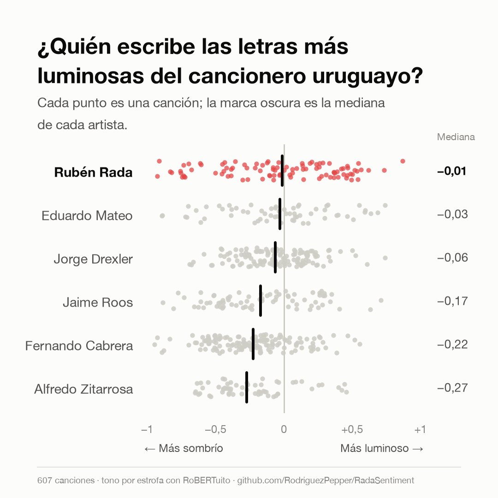
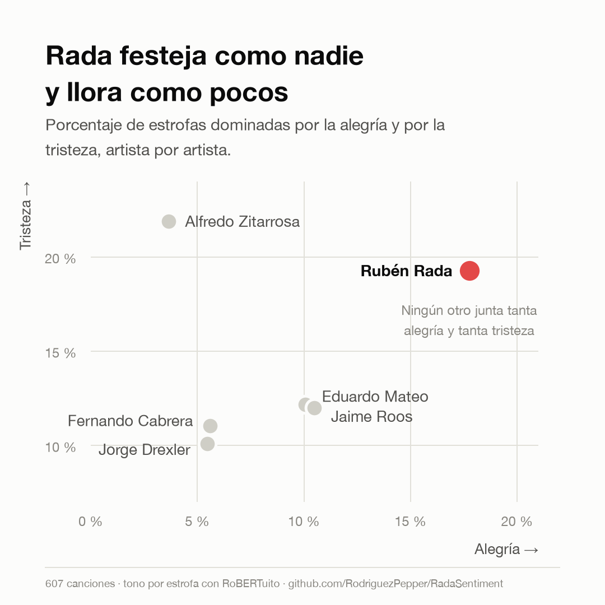
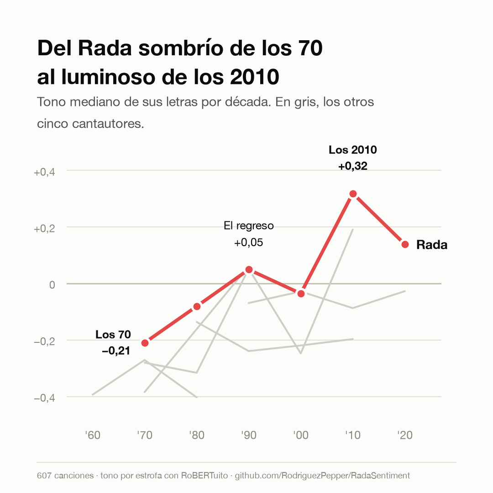

# RadaSentiment

Cuando murió Rubén Rada me quedé escuchando sus discos y con una pregunta dando vueltas: ¿es realmente el compositor más alegre de nuestra música, o es una impresión que nos deja el candombe? Este proyecto es mi intento de contestarla con datos.

Tomé las letras que escribió entre 1965 y 2025 y las comparé con las de otros cinco grandes del cancionero uruguayo: Jaime Roos, Alfredo Zitarrosa, Fernando Cabrera, Eduardo Mateo y Jorge Drexler. Me importaba medir lo que cada uno escribió, no lo que cantó, así que cada canción tiene su crédito de autoría verificado.



## Qué encontré

- Rada es el más luminoso del grupo. Tiene casi cinco veces más estrofas alegres que Zitarrosa (17,8 % contra 3,6 %), pero no es que no escriba tristeza: también ahí está arriba. Lo que lo distingue es la amplitud, el candombe que festeja y llora en la misma canción.
- En el otro extremo están Zitarrosa y Cabrera, con el cancionero más sombrío. La solemnidad de la milonga se ve en los números.
- El arco de Rada me pareció lo más lindo de todo. El de los 70 escribía oscuro (valencia mediana de −0,21) y el de los 2010 escribe luminoso (+0,32). El cambio llega con su regreso en los 90.
- Un detalle que me hizo repensar las conclusiones: si comparo a Rada y Zitarrosa solo en las décadas en que los dos grabaron, la mitad de la diferencia desaparece. Parte de lo que parecía ser "el artista" era en realidad "la época".





El informe completo, con todas las figuras, está en [informe/informe.html](informe/informe.html), y las tablas estadísticas en [results/estadistica.md](results/estadistica.md).

## Cómo lo hice

Armé el catálogo de cada artista desde MusicBrainz y bajé las letras de tres fuentes (Genius, LRCLIB y letras.com) para cubrir los huecos de cada una. Después:

1. Partí cada letra en estrofas y las clasifiqué (positivo, negativo, neutro, emociones e ironía) con los modelos RoBERTuito de [pysentimiento](https://github.com/pysentimiento/pysentimiento). Los resultados por estrofa los agregué a nivel canción.
2. Como segunda mirada, independiente del modelo, calculé valencia y arousal con las normas léxicas en español de Stadthagen-González et al. (2016). El ranking de artistas se sostiene con los dos métodos.
3. Para comparar artistas usé Kruskal-Wallis, post-hoc de Dunn, delta de Cliff e intervalos bootstrap, y controlé el cruce entre artista y década.

Escribí todas las reglas del análisis en [METODO.md](METODO.md) antes de correr nada, para no acomodar el método a los resultados.

Una advertencia honesta: estos modelos se entrenaron con tweets, no con poesía, y no tengo anotación humana para validar en este dominio. Tomá los resultados como exploratorios.

## Sobre las letras

Las letras tienen derechos de autor, así que no están en el repo. Acá solo hay código, metadatos, etiquetas por ID y resultados agregados. Si corrés el pipeline, las letras se descargan en tu máquina para el análisis local.

## Para correrlo

```bash
python3 -m venv .venv
source .venv/bin/activate
pip install -r requirements.txt
python -m spacy download es_core_news_md
cp .env.example .env   # y poné tu GENIUS_ACCESS_TOKEN
```

El token de Genius es gratis y se saca en https://genius.com/api-clients.

## Qué hay en cada carpeta

- `config/artistas.yaml`: Los artistas, sus IDs en Genius y MusicBrainz, y las épocas de Rada
- `src/adquisicion/`: Catálogo y descarga de letras
- `src/limpieza/`: Consolidación, autoría y exclusiones
- `src/analisis/`: Clasificación de sentimiento y capa léxica
- `src/estadistica/`: Tests y comparaciones
- `src/viz/`: Figuras e informe
- `data/catalogo/`: El canon discográfico y los créditos de cada canción
- `results/` e `informe/`: Tablas, figuras e informe final

---

Gracias, Rada, por tanta luz.
